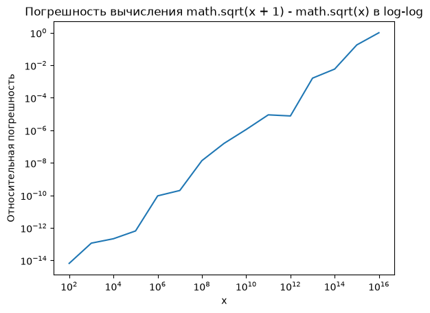
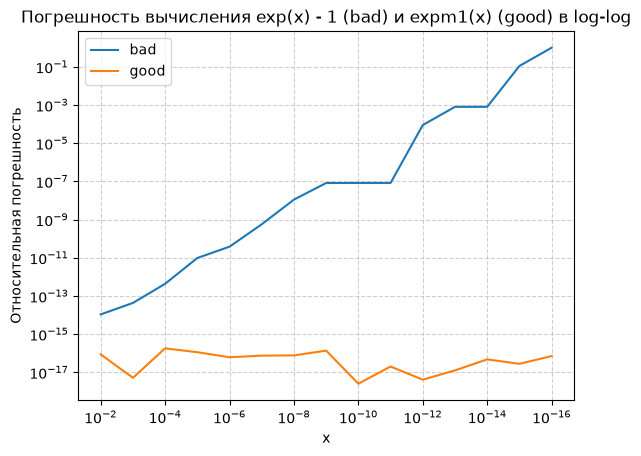

# Домашнее задание

Устойчивость алгоритма и корректная постановка эксперимента

## Блок 1. Обусловленность задачи (задачи 1–4)

### Задача 1. Число обусловленности вручную.

Для каждой функции вычислите число обусловленности cond = |x · f'(x) / f(x)| в указанной точке и определите, хорошо или плохо обусловлена задача:

1. f(x) = √x при x = 1e-8

2. f(x) = ln x при x = 1.001

3. f(x) = x - 1 при x = 1.000001

4. f(x) = sin x при x = π/2

Расположите задачи по возрастанию обусловленности.


```python
import math

table = []

title = '1. f(x) = √x при x = 1e-8'
x = 1e-8
cond = 0.5 # x * f'(x) / f(x) = 0.5 при любом x т.к. f'(x) = 1/(2√x)
table.append((cond, title))

title = '2. f(x) = ln x при x = 1.001'
x = 1.001
cond = abs(1/math.log(x)) # f'(x) = 1/x
table.append((cond, title))

title = '3. f(x) = x - 1 при x = 1.000001'
x = 1.000001
cond = abs(x / (x-1))
table.append((cond, title))

title = '4. f(x) = sin x при x = π/2'
x = math.pi / 2
cond = 0 # потому что f'(x)/f(x) = ctg(x) при x = pi/2 это 0
table.append((cond, title))

table.sort()
for i in table:
    print(f'{i[0]:10.1f} {i[1]}')

```

           0.0 4. f(x) = sin x при x = π/2
           0.5 1. f(x) = √x при x = 1e-8
        1000.5 2. f(x) = ln x при x = 1.001
     1000001.0 3. f(x) = x - 1 при x = 1.000001
    

### Вывод

Задачи №4 и №1 хорошо обусловлены, поскольку их числа обусловленности близки к нулю или меньше единицы. Задачи № 2 и № 3 плохо обусловлены: даже небольшая относительная погрешность входных данных может привести к значительной относительной погрешности результата.

Самая опасная — задача №3 f(x)=x-1, поскольку при x, близком к единице, происходит вычитание близких чисел. В результате небольшое изменение входного значения может вызвать большое относительное изменение результата.

### Задача 2. Вычитание близких чисел как плохая обусловленность.

Дана задача f(a, b) = a - b.

Покажите аналитически, что при a ≈ b число обусловленности по a и по b велико. 
> Число обусловленности по a  f(x) = x - b при x ≈ b  cond = b / (x - b)  стремится к бесконечности

> Число обусловленности по b  f(x) = a - x при x ≈ a  cond = a / (a - x)  стремится к бесконечности

Затем проверьте численно: возьмите a = 1 + 1e-8, b = 1 и посчитайте Δf / δa при δa = 1e-9. 


```python
a, b = 1 + 1e-8, 1
delta_a = 1e-9

f = lambda a: a - b

df = f(a + delta_a) - f(a)

cond = abs((df / f(a)) / (delta_a / a))

print(f'Абсолютное изменение результата: {abs(df):.3e}')
print(f'Относительное изменение результата: {abs(df / f(a)):.3e}')
print(f'Число обусловленности (эксперимент): {cond:.3e}')
print(f'Число обусловленности (аналитически): {abs(a / (a - b)):.3e}')
```

    Абсолютное изменение результата: 1.000e-09
    Относительное изменение результата: 1.000e-01
    Число обусловленности (эксперимент): 1.000e+08
    Число обусловленности (аналитически): 1.000e+08
    

### Вывод
При вычитании близких чисел задача становится плохо обусловленной, поскольку небольшое относительное изменение входных данных приводит к значительно большему относительному изменению результата. В эксперименте относительное изменение результата составило около 10%, хотя относительное изменение входного значения было порядка 1e-9. Это подтверждает предсказание числа обусловленности: задача очень чувствительна к погрешностям входных данных.

### Задача 3. Кратные корни — плохая обусловленность.

Рассмотрите уравнение x^2 - 2x + 1 = 0 (корень x = 1 кратности 2).

Измените свободный член на 1 - ε для ε = 1e-2, 1e-4, 1e-6. 

Найдите корни через math.sqrt и посмотрите, насколько сдвинулся корень относительно x = 1. 
> Уравнение будет именть вид x^2 -2x + (1 - ε) => x = 1 ± √ε, а т.к. нужен только сдвиг корня это √ε

Постройте таблицу: ε → сдвиг корня → отношение сдвигов. Сделайте вывод о связи кратности корня и обусловленности.


```python
e_val = [1e-2, 1e-4, 1e-6]
print(f"{'ε  ':>10} {'Δ  ':>10} {'Δ/ε':>10}")
for e in e_val:
    delta = math.sqrt(e)
    print(f'{e:10.0e} {delta:10.0e} {delta/e:10.0f}')
```

           ε          Δ          Δ/ε
         1e-02      1e-01         10
         1e-04      1e-02        100
         1e-06      1e-03       1000
    

В таблице первый столбец - это приращение c, второй столбец - это приращение корня, а третий отношение приращения корня к приращению c.

### Вывод:
Кратные корни обладают плохой обусловленностью. При изменении свободного члена на величину ε сдвиг корня пропорционален √ε, а не ε. Поэтому даже очень малое возмущение коэффициентов может вызвать относительно большой сдвиг корней. Чем выше кратность корня, тем сильнее чувствительность корней к возмущениям коэффициентов.

### Задача 4. Обусловленность vs устойчивость — различие.

>Приведите **свой** пример (не из лекции) задачи, которая **хорошо обусловлена**, но для которой можно написать **неустойчивый** алгоритм. Реализуйте оба: устойчивый и неустойчивый варианты, покажите расхождение на диапазоне входных данных. В выводе чётко разделите: «в чём проблема задачи» и «в чём проблема алгоритма».

#### Математическая задача

Функция `hypot(x, y)` вычисляет длину гипотенузы прямоугольного треугольника.

Эта задача хорошо обусловлена: небольшие относительные изменения входных значений вызывают небольшие относительные изменения результата.

#### Два алгоритма

Неустойчивый вариант:

```
math.sqrt(x*x + y*y)
```

Проблема в том, что при возведении больших чисел в квадрат может произойти переполнение (`inf`), а при возведении очень маленьких чисел — округление до нуля.

Устойчивый вариант:

```
math.hypot(x, y)
```

#### Проверка на разных входных данных


```python
values = [(3.0, 4.0), (1e200, 1e200), (1e-200, 1e-200),  (1e-300, 1e-300)]

print(f'{"x":>12} {"bad":>15} {"good":>15}')

for x, y in values:
    bad = math.sqrt(x*x + y*y)

    good = math.hypot(x, y)

    print(f'{x:12.1e} {str(bad):>15} {good:15.5e}')
```

               x             bad            good
         3.0e+00             5.0     5.00000e+00
        1.0e+200             inf    1.41421e+200
        1.0e-200             0.0    1.41421e-200
        1.0e-300             0.0    1.41421e-300
    

#### Обусловленность и устойчивость

Сама функция

$$ f(x,y)=\sqrt{x^2+y^2} $$

хорошо обусловлена. Небольшое относительное изменение входных значений не приводит к катастрофическому изменению результата.

Проблема алгоритма (устойчивость):

Прямое вычисление через `x*x + y*y` может привести к переполнению или потере малых значений ещё до вычисления квадратного корня. Это недостаток выбранного способа вычисления, а не математической задачи.

`math.hypot()` использует более подходящий алгоритм, который учитывает масштаб входных значений.

### Вывод

В качестве примера рассмотрена задача вычисления гипотенузы. Математическая задача хорошо обусловлена, однако её прямое вычисление через возведение аргументов в квадрат может приводить к переполнению или потере малых значений. Использование `math.hypot()` позволяет избежать этих проблем и получить корректный результат на значительно более широком диапазоне входных данных. Таким образом, обусловленность характеризует чувствительность самой математической задачи к изменению входных данных, а устойчивость — способность выбранного алгоритма сохранять точность вычислений.


## Блок 2. Устойчивость алгоритма (задачи 5–9)

### Задача 5. Квадратное уравнение — классика

Для a = 1, b = 1e8, c = 1 вычислите меньший корень двумя способами:

«плохо»: x₂ = (-b + √(b² - 4ac)) / 2a

«хорошо»: x₂ = 2c / (-b - √(b² - 4ac))

Сравните с эталоном через mpmath (или decimal с 50 знаками).

Посчитайте относительную погрешность обоих способов. Повторите для b = 1e4 и b = 1e12. 

Постройте таблицу: b → ошибка плохого → ошибка хорошего.

Сделайте вывод: при каком b «плохой» способ начинает катастрофически ошибаться?


```python
import decimal

decimal.getcontext().prec = 50
a, c = 1, 1
print('  b    δ плохого δ хор.')
for b in (10000, 100000000, 1000000000000):
    x1 = (-b + math.sqrt(b*b - 4*a*c)) / (2 * a)
    x2 = 2*c / (-b - math.sqrt(b*b - 4*a*c))
    x3 = float(decimal.Decimal(2*c) / (decimal.Decimal(-b) - decimal.Decimal(b*b - 4*a*c).sqrt()))
    delta1 = abs(x1 - x3)
    rel1 = abs(delta1 / x3)
    delta2 = abs(x2 - x3)
    rel2 = abs(delta2 / x3)
    print(f'{b:5.0e} {rel1:10.4g} {rel2}')


```

      b    δ плохого δ хор.
    1e+04  1.118e-09 0.0
    1e+08     0.2549 0.0
    1e+12          1 0.0
    

### Вывод
Расчет по хорошей формуле совпадает с decimal с точностью которое может обеспечить float. При b = 1e8 погрешность уже превышает 25%


### Задача 6. (1 - cos x) при малых x.

Реализуйте два способа вычисления f(x) = (1 - cos x) / x²:

«плохо»: прямо в лоб;

«хорошо»: через тождество 2·sin²(x/2) / x².

Прогоните x = 1e-2, 1e-4, 1e-6, 1e-8, 1e-10. Эталон — через mpmath. 

Постройте таблицу относительной ошибки обоих способов от x в log масштабе. 

Определите, при каком x ошибка «плохого» способа превышает 1%. 

Сформулируйте правило, когда нужно искать тригонометрическое тождество.


```python
from mpmath import mp

mp.dps = 50
print('Таблица относительных погешностей для x = 10^(-n)')
print(f' n {"δ плохого метода":>20} {"δ хорощего метода":>20}')
for n in range(1, 11):
    x_exact = mp.mpf(f'1e-{n}')
    x = float(x_exact)
    bad = (1 - math.cos(x)) / (x * x)
    good = (2 * math.sin(x/2)**2) / (x * x)
    exact = (2 * mp.sin(x_exact/2)**2) / (x_exact * x_exact)
    rel_bad = abs((bad - exact)/exact)
    rel_good = abs((good - exact)/exact)
    print(f'{n:2} {mp.nstr(rel_bad, 10):>20} {mp.nstr(rel_good,10):>20}')

print('-----')
print('Таблица изменения относительных погешностей в % внутри диапазонов 10^(-n) (для x = 10^(-n) * k)')
print(' n\\k', end='')
for k in range(1, 10):
    print(f'{k:6} ', end=' ')
print()

for n in range(7, 10):
    print(f'{n:2}', end=' ')
    for k in range(1, 10):
        x_exact = mp.mpf(k) * mp.mpf(f'1e-{n}')
        x = float(x_exact)

        bad = (1 - math.cos(x)) / (x * x)
        exact = 2 * mp.sin(x_exact / 2)**2 / x_exact**2

        rel_bad = abs((bad - exact) / exact)

        print(f'{float(rel_bad)*100:6.2f}%', end = ' ')
    print()

```

    Таблица относительных погешностей для x = 10^(-n)
     n     δ плохого метода    δ хорощего метода
     1      1.112467786e-14      1.243059955e-16
     2      2.884356535e-13      1.137151538e-16
     3      1.566293058e-11      1.386833168e-17
     4       5.244137642e-9      1.528165181e-16
     5       8.274870411e-8      1.117118333e-16
     6       8.890058242e-5      4.441581602e-17
     7      0.0007992778374       5.61772161e-17
     8                  1.0      8.333333333e-18
     9                  1.0      8.333333333e-20
    10                  1.0      8.333333333e-22
    -----
    Таблица изменения относительных погешностей в % внутри диапазонов 10^(-n) (для x = 10^(-n) * k)
     n\k     1       2       3       4       5       6       7       8       9  
     7   0.08%   0.08%   0.08%   0.06%   0.01%   0.02%   0.01%   0.01%   0.00% 
     8 100.00%  11.02%   1.31%   2.86%   2.30%   1.31%   0.31%   0.61%   1.31% 
     9 100.00% 100.00% 100.00% 100.00% 100.00% 100.00% 100.00% 100.00% 100.00% 
    

### Выводы:
* При вычислении \(1-\cos(x)\) для малых значений x происходит потеря точности из-за вычитания близких чисел. При \(x=10^{-8}\) ошибка плохого способа достигает 100%, тогда как хорошая формула сохраняет высокую точность. При вычислениях с плавающей точкой следует искать математические тождества, позволяющие избежать вычитания близких чисел и других операций, приводящих к потере значащих цифр.

* При уменьшении x погрешность прямого вычисления (1-cos x)/x^2 не увеличивается монотонно, а скачкообразно изменяется. Это связано с ограниченной точностью типа float: значение cos(x) округляется, а при вычитании из единицы теряются значащие цифры. Для некоторых значений x косинус округляется до 1.0, из-за чего числитель становится равен нулю и относительная ошибка достигает 100%. Поэтому нельзя определить универсальную границу, ниже которой формула всегда даёт определённую ошибку.

### Задача 7. √(x+1) - √x при больших x.

Реализуйте два способа:

«плохо»: √(x+1) - √x;

«хорошо»: 1 / (√(x+1) + √x).

Прогоните x = 1e4, 1e8, 1e12, 1e14, 1e16. Эталон — mpmath с 50 знаками.

Постройте таблицу относительной ошибки. 

Определите, как ошибка «плохого» способа растёт с x (оцените показатель степени).

Сделайте вывод.


```python
print('Таблица относительных погешностей для x = 10^n')
print(f' n {"δ плохого метода":>20} {"δ хорощего метода":>20}')
xx = []
rb = []
for n in range(4, 17):
    x_exact = mp.mpf(f'1e{n}')
    x = float(x_exact)
    bad = math.sqrt(x + 1) - math.sqrt(x)
    good = 1 / (math.sqrt(x + 1) + math.sqrt(x))
    exact = 1 / (mp.sqrt(x_exact + 1) + mp.sqrt(x_exact))
    rel_bad = abs((bad - exact)/exact)
    rel_good = abs((good - exact)/exact)
    print(f'{n:2} {mp.nstr(rel_bad, 10):>20} {mp.nstr(rel_good,10):>20}')
    xx.append(x) # запоминаем для расчета показателя степени
    rb.append(rel_bad)


p = math.log(rb[-1] / rb[0]) / math.log(xx[-1] / xx[0])
print(f'Показатель степени на всем диапазоне {p:.4}')
p = math.log(rb[-3] / rb[2]) / math.log(xx[-3] / xx[2])
print(f'Показатель степени от 10^6 до 10^14 {p:.4}')

```

    Таблица относительных погешностей для x = 10^n
     n     δ плохого метода    δ хорощего метода
     4      2.130466259e-13       1.72576149e-17
     5      6.422379088e-13      1.377762331e-16
     6      9.255884886e-11      5.257405208e-17
     7      1.976994362e-10      7.863983096e-17
     8       1.361766326e-8      9.011402868e-17
     9       1.562450128e-7       3.74412456e-17
    10       1.116630767e-6      7.377018269e-17
    11       8.899264836e-6      6.159623003e-17
    12        7.61449362e-6      1.317295651e-16
    13       0.001610906052      1.559845873e-16
    14       0.005828380585      5.988095034e-17
    15         0.1780402288      3.808757848e-18
    16                  1.0      4.592256083e-17
    Показатель степени на всем диапазоне 1.056
    Показатель степени от 10^6 до 10^14 0.9749
    

### Вывод

При больших значениях \(x\) выражение $ \sqrt{x+1} - \sqrt{x} $ становится разностью двух близких чисел, что приводит к потере значащих цифр. Относительная ошибка плохого способа в целом растёт примерно пропорционально \(x\), хотя из-за округления её рост не является строго монотонным. Преобразование выражения с помощью сопряжённого позволяет избежать вычитания близких чисел. Поэтому хороший способ сохраняет точность вычислений на всём проверенном диапазоне значений.

Показатель степени примерно 1


### Задача 8. Экспонента и логарифм.

Для f(x) = ln(1 + x) при малых x реализуйте:

«плохо»: math.log(1 + x);

«хорошо»: math.log1p(x) .

Прогоните x = 1e-2, 1e-8, 1e-12, 1e-16. Эталон — mpmath.log1p(x).

Посчитайте относительную ошибку обоих способов. 


```python
print('Таблица относительных погешностей для x = 10^(-n)')
print(f' n {"δ плохого метода":>20} {"δ хорощего метода":>20}')
for n in range(2, 17):
    x_exact = mp.mpf(f'1e-{n}')
    x = float(x_exact)
    bad = math.log(1 + x)
    good = math.log1p(x)
    exact = mp.log1p(x_exact) 
    rel_bad = abs((bad - exact)/exact)
    rel_good = abs((good - exact)/exact)
    print(f'{n:2} {mp.nstr(rel_bad, 10):>20} {mp.nstr(rel_good,10):>20}')

```

    Таблица относительных погешностей для x = 10^(-n)
     n     δ плохого метода    δ хорощего метода
     2      9.213249717e-16      4.963361716e-17
     3      1.100112444e-13      1.818422622e-17
     4      1.101460099e-13      4.154490508e-17
     5       6.55109124e-12      6.373603495e-17
     6      8.226661262e-11      2.120680202e-17
     7      5.838671324e-10      1.188883155e-16
     8       6.077470954e-9      6.871343297e-17
     9       8.274037097e-8      1.265738265e-17
    10       8.274037104e-8      7.032733054e-17
    11       8.274037092e-8      1.411237484e-16
    12       8.890058234e-5      4.433129247e-17
    13      0.0007992778374      7.807095408e-17
    14      0.0007992778374      4.989048406e-17
    15         0.1102230246      1.832749473e-16
    16                  1.0      2.909778672e-17
    

Зачем в стандартной библиотеке есть «странные» функции типа log1p, expm1, hypot.

| Функция       | Что вычисляет        | Какую проблему решает                                         |
| ------------- | -------------------- | ------------------------------------------------------------- |
| `log1p(x)`    | $ \ln(1+x)\ $        | Потеря точности при сложении 1+x                              |
| `expm1(x)`    | $ e^x-1\ $           | Потеря точности при вычитании единицы                         |
| `hypot(x, y)` | $ \sqrt{x^2+y^2} $   | Переполнение и потеря малых значений при возведении в квадрат |


### Вывод
Специальные функции стандартной библиотеки, такие как log1p, expm1 и hypot, предназначены для повышения численной устойчивости вычислений. Они позволяют избежать потери точности при операциях с близкими числами, а также переполнения и потери малых значений. Несмотря на то что математически эти функции можно заменить обычными выражениями, на компьютере такая замена не всегда даёт одинаково точный результат. Поэтому при разработке численных алгоритмов важно использовать специализированные функции стандартной библиотеки, если они существуют для нужной операции.

### Задача 9. Неустойчивость накопления в сумме.

Вычислите Sₙ = Σ (k = 1..n) 1/k для n = 1e5, 1e6, 1e7 тремя способами:

1. наивный цикл слева направо;

2. sum(arr) ;

3. math.fsum(arr) .

Эталон — mpmath с 50 знаками. 

Для каждого n посчитайте относительную ошибку всех трёх способов. 

Постройте таблицу ошибки от n в log масштабе. Оцените, как растёт ошибка наивного способа с n. 

Сделайте вывод: при каком n наивная сумма становится неприемлемой (ошибка > 1e-10)?


```python
print(f'  n   {"цикл ":>15} {"sum ":>15} {"fsum ":>15}')
for n in (100000, 1000000, 10000000):
    s1 = 0.0
    for k in range(1, n+1):
        s1 += 1/k
    s2 = sum(1/k for k in range(1, n+1))
    s3 = math.fsum(1/k for k in range(1, n+1))
    s4 = mp.harmonic(n)
    r1 = abs((s1 - s4)/s4)
    r2 = abs((s2 - s4)/s4)
    r3 = abs((s3 - s4)/s4)
    print(f'{n:5.0e} {mp.nstr(r1, 5, strip_zeros=False):>15} {mp.nstr(r2, 5, strip_zeros=False):>15} {mp.nstr(r3, 5, strip_zeros=False):>15}')

```

      n             цикл             sum            fsum 
    1e+05      7.6851e-15      4.4908e-17      4.4908e-17
    1e+06      5.1050e-14      4.6325e-17      4.6325e-17
    


    ---------------------------------------------------------------------------

    KeyboardInterrupt                         Traceback (most recent call last)

    Cell In[37], line 6
          2 for n in (100000, 1000000, 10000000):
          3     s1 = 0.0
          4     for k in range(1, n+1):
          5         s1 += 1/k
    ----> 6     s2 = sum(1/k for k in range(1, n+1))
          7     s3 = math.fsum(1/k for k in range(1, n+1))
          8     s4 = mp.harmonic(n)
          9     r1 = abs((s1 - s4)/s4)
    

    Cell In[37], line 6, in <genexpr>(.0)
    ----> 6 print(f'  n   {"цикл ":>15} {"sum ":>15} {"fsum ":>15}')
    

    KeyboardInterrupt: 


### Выводы
* Встроенная функция sum() и math.fsum() показали одинаковую точность на проверенных значениях, однако math.fsum() предназначена специально для более точного суммирования чисел с плавающей точкой. Порог ошибки 1e-10 не был достигнут ни при одном из проверенных значений n.

* Относительная ошибка наивного суммирования в целом увеличивается с ростом количества слагаемых, однако не очень быстро. Это связано с тем, что округления при сложении могут происходить как в большую, так и в меньшую сторону, частично компенсируя друг друга.


## Блок 3. Корректная постановка эксперимента (задачи 10–15)

### Задача 10. Разделение источников ошибки.

Возьмите задачу из задачи 6. Проведите **три** эксперимента:

(а) меняем x, фиксируем алгоритм (плохой) — видим рост ошибки из-за обусловленности/сокращения;

(б) фиксируем x, меняем тип float (float32 через numpy.float32 vs float64) — видим рост ошибки из-за машинной точности;

(в) меняем алгоритм (плохой vs хороший), фиксируем x — видим эффект устойчивости.

Оформите таблицу: какой фактор на сколько порядков меняет ошибку. Сформулируйте вывод: какой источник в каждом случае доминирует.


```python
x_exact = mp.mpf('1e-3')
x = float(x_exact)
bad1 = (1 - math.cos(x)) / (x * x)
exact1 = (2 * mp.sin(x_exact/2)**2) / (x_exact * x_exact)
x_exact = mp.mpf('1e-4')
x = float(x_exact)
bad2 = (1 - math.cos(x)) / (x * x)
exact2 = (2 * mp.sin(x_exact/2)**2) / (x_exact * x_exact)
rel_bad1 = abs((bad1 - exact1)/exact1)
rel_bad2 = abs((bad2 - exact2)/exact2)

import numpy as np
x32 = np.float32('1e-3')
fl32 = (np.float32(1) - np.cos(x32)) / (x32 * x32)
rel_fl32 = abs((fl32 - exact1)/exact1)

x = 1e-3
good = (2 * math.sin(x/2)**2) / (x * x)
rel_good = abs((good - exact1)/exact1)

v1 = round(mp.log10(rel_bad2/rel_bad1))
v2 = round(mp.log10(rel_fl32/rel_bad1))
v3 = round(mp.log10(rel_good/rel_bad1))
print(mp.nstr(rel_bad2/rel_bad1, 4))
print(mp.nstr(rel_fl32/rel_bad1, 4))
print(mp.nstr(rel_bad1/rel_good, 4))
print()


print('    изменение                 влияние (в порядках)')
print(f'Уменьшение x от 1e-3 до 1e-4  {v1:8}')
print(f'float64->float32              {v2:8}')
print(f'Плохой → хороший алгоритм     {v3:8}')

```

    334.8
    2.958e+9
    1.129e+6
    
        изменение                 влияние (в порядках)
    Уменьшение x от 1e-3 до 1e-4         3
    float64->float32                     9
    Плохой → хороший алгоритм           -6
    

### Вывод:
В ходе экспериментов были рассмотрены три источника влияния на точность вычислений. При уменьшении x ошибка плохого алгоритма увеличилась примерно в 335 раз из-за потери значащих цифр при вычитании близких чисел. Замена float64 на float32 увеличила ошибку почти в 3e9 раз из-за меньшей машинной точности. Замена плохой формулы на устойчивую уменьшила ошибку примерно в миллион раз. Таким образом, на точность влияют как используемый тип данных, так и выбранный алгоритм.


### Задача 11. Эталон — обязателен.

Придумайте (или возьмите из задач 5–9) пример, в котором два **float-результата** совпадают

между собой, но **оба неверны** относительно точного эталона. Реализуйте: два алгоритма, сравнение друг с другом через == , сравнение каждого с mpmath. 

Я взял функцию 
$$ f(x) = \frac{1 - cos(x)} {x^2} $$

Вычислять буду двумя способами при x = 1e-8
```
bad1 = (1 - math.cos(x)) / (x**2)
bad2 = 1/x/x - math.cos(x)/x/x
```


```python
x = 1e-8
x_exact = mp.mpf('1e-8')

bad1 = (1 - math.cos(x)) / (x**2)
bad2 = 1/x/x - math.cos(x)/x/x

exact = (2 * mp.sin(x_exact/2)**2) / (x_exact * x_exact)

print("Алгоритм 1:", bad1)
print("Алгоритм 2:", bad2)
print("Совпадают:", bad1 == bad2)
print("Эталон:", mp.nstr(exact, 30))    

    


```

    Алгоритм 1: 0.0
    Алгоритм 2: 0.0
    Совпадают: True
    Эталон: 0.499999999999999995833333333333
    

### Вывод
В эксперименте два разных алгоритма вычисления вернули одинаковый результат float, однако оба результата отличались от значения, рассчитанного с высокой точностью с помощью mpmath. Это произошло из-за потери значащих цифр при вычитании близких чисел. Таким образом, совпадение результатов двух алгоритмов не гарантирует их правильность: они могут иметь одинаковый источник ошибки. Для проверки численных вычислений необходимо сравнивать результат с независимым эталоном, рассчитанным с повышенной точностью.

### Задача 12. Диапазон, а не одна точка.

Для функции из задачи 7 прогоните x от 1e2 до 1e16 (минимум 8 точек, логарифмическая сетка).

Постройте график ошибки в log-log.


```python
xx = []
yy = []
for n in range(2, 17):
    x_exact = mp.mpf(f'1e{n}')
    x = float(x_exact)
    bad = math.sqrt(x + 1) - math.sqrt(x)
    exact = 1 / (mp.sqrt(x_exact + 1) + mp.sqrt(x_exact))
    rel_bad = abs((bad - exact)/exact)
    xx.append(x)
    yy.append(float(rel_bad))

import matplotlib.pyplot as plt

plt.plot(xx, yy)
plt.xscale('log')
plt.yscale('log') 
plt.xlabel("x")
plt.ylabel("Относительная погрешность")
plt.title("Погрешность вычисления math.sqrt(x + 1) - math.sqrt(x) в log-log")

plt.show()

```


    

    


Оцените наклон прямой (показатель степени). 
> По графику видно что наклон прямой примерно равен 1 (0 - -14) / (16 - 2)

Сравните с теоретической оценкой: ошибка «плохого» способа ≈ εmachine · x. 
> Совападает показатель степени примерно 1

### Вывод
По графику в логарифмических координатах наблюдается приблизительно линейный рост ошибки. Оценённый показатель степени близок к 1, что соответствует теоретической оценке. Небольшие отклонения от прямой связаны с округлением чисел с плавающей точкой. Использование диапазона значений позволяет увидеть общую закономерность и отличить её от случайных колебаний ошибки в отдельных точках.


### Задача 13. Воспроизводимость эксперимента.

Напишите эксперимент, который генерирует 1e5 случайных чисел через random.seed(42) и numpy.random.default_rng(42). 

Суммируйте их тремя способами ( sum, math.fsum, numpy.sum ). 

Запустите **дважды** с одним seed — результаты должны совпасть. 

Запустите с seed=43 — покажите, что расхождения между способами не «случайны», а систематичны.

Оформите отчёт с указанием: версия Python, версия numpy, seed. 

Сделайте вывод о том, почему без фиксации seed и версий эксперимент не воспроизводим.


```python
import numpy as np
import random
import sys

print('Версия Python', sys.version.split()[0]) 
print('Версия numpy', np.__version__)

def C(v:bool):
    return ('отличаются', 'совпадают')[int(v)]

SEED = 42
SEED2 = 43
N = 100000

print(f'Суммирование {N} python random чисел, SEED = {SEED}')
# Генератор стандартной библиотеки
random.seed(SEED)
py_random = [random.random() for _ in range(N)]

# Генератор NumPy
rng = np.random.default_rng(SEED)
numpy_random = rng.random(N)

sum_1_py = sum(py_random)
fsum_1_py = math.fsum(py_random)
npsum_1_py = np.sum(py_random)

print('sum fsum      ', C(sum_1_py==fsum_1_py))
print('sum numpy.sum ', C(sum_1_py==npsum_1_py))
print('fsum numpy.sum', C(fsum_1_py==npsum_1_py))

print(f'Суммирование {N} numpy random чисел, SEED = {SEED}')

sum_1_np = sum(numpy_random)
fsum_1_np = math.fsum(numpy_random)
npsum_1_np = np.sum(numpy_random)

print('sum fsum      ', C(sum_1_np==fsum_1_np))
print('sum numpy.sum ', C(sum_1_np==npsum_1_np))
print('fsum numpy.sum', C(fsum_1_np==npsum_1_np))

print(f'Проверка совпадения сумм для генераторов python и numpy')

print('sum       ', C(sum_1_py==sum_1_np))
print('fsum      ', C(fsum_1_py==fsum_1_np))
print('numpy.sum ', C(npsum_1_py==npsum_1_np))

print(f'Повторное генерирование и суммирование с SEDD = {SEED}')
# Генератор стандартной библиотеки
random.seed(SEED)
py_random = [random.random() for _ in range(N)]

# Генератор NumPy
rng = np.random.default_rng(SEED)
numpy_random = rng.random(N)

sum_2_py = sum(py_random)
fsum_2_py = math.fsum(py_random)
npsum_2_py = np.sum(py_random)

sum_2_np = sum(numpy_random)
fsum_2_np = math.fsum(numpy_random)
npsum_2_np = np.sum(numpy_random)

print('Проверка совпадения сумм 1го и 2го запуска для разных генераторов')
print('функция   python    numpy')
print(f'sum       {C(sum_1_py==sum_2_py)} {C(sum_1_np==sum_2_np)}')
print(f'fsum      {C(fsum_1_py==fsum_2_py)} {C(fsum_1_np==fsum_2_np)}')
print(f'numpy.sum {C(npsum_1_py==npsum_2_py)} {C(npsum_1_np==npsum_2_np)}')

print(f'Суммирование {N} numpy random чисел, SEED = {SEED2}')
# Генератор NumPy
rng = np.random.default_rng(SEED2)
numpy_random = rng.random(N)

sum_3_np = sum(numpy_random)
fsum_3_np = math.fsum(numpy_random)
npsum_3_np = np.sum(numpy_random)

print('sum fsum      ', C(sum_3_np==fsum_3_np))
print('sum numpy.sum ', C(sum_3_np==npsum_3_np))
print('fsum numpy.sum', C(fsum_3_np==npsum_3_np))

print('Проверка совпадения сумм 1го и 3го запуска (разные SEED) ')
print(f'sum       {C(sum_1_np==sum_3_np)}')
print(f'fsum      {C(fsum_1_np==fsum_3_np)}')
print(f'numpy.sum {C(npsum_1_np==npsum_3_np)}')

```

    Версия Python 3.12.10
    Версия numpy 2.5.3
    Суммирование 100000 python random чисел, SEED = 42
    sum fsum       совпадают
    sum numpy.sum  совпадают
    fsum numpy.sum совпадают
    Суммирование 100000 numpy random чисел, SEED = 42
    sum fsum       отличаются
    sum numpy.sum  отличаются
    fsum numpy.sum совпадают
    Проверка совпадения сумм для генераторов python и numpy
    sum        отличаются
    fsum       отличаются
    numpy.sum  отличаются
    Повторное генерирование и суммирование с SEDD = 42
    Проверка совпадения сумм 1го и 2го запуска для разных генераторов
    функция   python    numpy
    sum       совпадают совпадают
    fsum      совпадают совпадают
    numpy.sum совпадают совпадают
    Суммирование 100000 numpy random чисел, SEED = 43
    sum fsum       отличаются
    sum numpy.sum  отличаются
    fsum numpy.sum совпадают
    Проверка совпадения сумм 1го и 3го запуска (разные SEED) 
    sum       отличаются
    fsum      отличаются
    numpy.sum отличаются
    

### Вывод:
Фиксация seed обеспечивает воспроизводимость последовательности псевдослучайных чисел при использовании одного и того же генератора. Однако генераторы random и numpy.random используют разные алгоритмы, поэтому при одинаковом seed создают разные последовательности. Кроме того, результаты суммирования могут отличаться из-за особенностей алгоритмов и округления чисел с плавающей точкой. Для воспроизводимости эксперимента необходимо фиксировать seed, используемый генератор, версии Python и библиотек, а также способ вычислений.

### Задача 14. Границы представимости.

Проверьте поведение наивного суммирования и fsum на массиве, содержащем:

очень большие числа (≈ 1e300), очень маленькие (≈ 1e-300), ноль, денормализованные числа (≈ 1e-320),  float('inf') , float('nan').


```python
print('1) Суммирование без inf и nan')
data =  [1e300, 1e-300, 0.0, 1e-320]*10
s1 = 0.0
for i in data:
    s1 += i
s2 = math.fsum(data)
print(f'Наивная сумма {s1:20g}')
print(f'fsum          {s2:20g}')

print('2) Суммирование без inf и nan, но у каждого большого числа есть противоположное')
data =  [1e300, 1e-300, 0.0, 1e-320, -1e300]*10
s1 = 0.0
for i in data:
    s1 += i
s2 = math.fsum(data)
print(f'Наивная сумма {s1:20g}')
print(f'fsum          {s2:20g}')


print('3) Суммирование c inf ')
data = [1e300, 1e-300, 0.0, 1e-320, float('inf'), -1e300]*10
s1 = 0.0
for i in data:
    s1 += i
s2 = math.fsum(data)
print(f'Наивная сумма {s1:20g}')
print(f'fsum          {s2:20g}')

print('4) Суммирование c inf разных занокв')
data = [1e300, 1e-300, 0.0, 1e-320, float('inf'), -1e300, float('-inf')]*10
s1 = 0.0
for i in data:
    s1 += i
try:
    s2 = math.fsum(data)
except ValueError:
    s2 = 'ValueError'
print(f'Наивная сумма {s1:20g}')
print(f'fsum          {s2:>20}')

print('5) Суммирование c inf и nan')
data = [1e300, 1e-300, 0.0, 1e-320, float('inf'), float('nan')]*10
s1 = 0.0
for i in data:
    s1 += i
try:
    s2 = math.fsum(data)
except ValueError:
    s2 = 'ValueError'
print(f'Наивная сумма {s1:20g}')
print(f'fsum          {s2:>20}')

```

    1) Суммирование без inf и nan
    Наивная сумма               1e+301
    fsum                        1e+301
    2) Суммирование без inf и nan, но у каждого большого числа есть противоположное
    Наивная сумма                    0
    fsum                        1e-299
    3) Суммирование c inf 
    Наивная сумма                  inf
    fsum                           inf
    4) Суммирование c inf разных занокв
    Наивная сумма                  nan
    fsum                    ValueError
    5) Суммирование c inf и nan
    Наивная сумма                  nan
    fsum                           nan
    

**Что произойдёт с каждым способом на обычных/малых числах (кейсы 1 и 2)?**
   * **Наивное суммирование** накапливает критическую погрешность (машинное округление). В кейсе 2, когда к `1e300` прибавляется `1e-300` или `1e-320`, малые числа полностью «тонут» в младших разрядах мантиссы и при последующем вычитании `-1e300` получается точный `0.0`. Произошла катастрофическая потеря точности (поглощение).
   * **`math.fsum`** отслеживает промежуточные суммы с полной точностью. Малые слагаемые не теряются при наличии огромных, и в кейсе 2 мы получаем точный результат `1e-299`.
   * Денормализованные числа (`1e-320`) в наивной сумме поглощаются мгновенно, а `fsum` учитывает их без деградации точности.

2. **Какой способ «отвалится» в `NaN` сразу, а какой — нет?**
   * **Наивное суммирование** «отваливается» в `NaN` **постепенно (потоково)**: 
     * До тех пор, пока цикл не дошел до `float('nan')` или неопределенности $\infty - \infty$, сумма является валидным числом.
     * Как только встретился `NaN` или операция $\infty - \infty$, результат по стандарту IEEE 754 становится `NaN` и дальше просто «размазывается» (любая операция `NaN + x` дает `NaN`).
   * **`math.fsum`** «отваливается» **глобально**:
     * `fsum` анализирует весь массив. 
     * Если в массиве есть противоположные бесконечности (`inf` и `-inf`), `fsum` **не возвращает NaN**, а падает с исключением `ValueError`. Это принципиальное отличие: наивная сумма «проглатывает» неопределенность, тихо превращая её в `NaN`, а `fsum` прерывает выполнение программы исключением.
     * При этом, если в массиве есть и `NaN`, и `+inf`, и `-inf` (как в вашем кейсе 5), `fsum` всё равно выбросит `ValueError`, так как проверка на взаимоуничтожающиеся бесконечности имеет приоритет.

3. **Как ведёт себя `fsum` при наличии `inf`?**
   * Если в массиве присутствуют бесконечности **одного знака** (`inf` и любые конечные числа / нули) — возвращает `inf` (или `-inf`).
   * Если встречаются бесконечности **разных знаков** (`inf` и `-inf`) — выбрасывает `ValueError` (в отличие от наивного суммирования, которое по IEEE 754 тихо возвращает `NaN`).

---

#### Сводная таблица поведения

| Сценарий / Входные данные | Наивное суммирование (`sum` / `+=`) | `math.fsum` | Особенности поведения |
| :--- | :--- | :--- | :--- |
| **Нормальные + малые + денормализованные** (`1e300`, `1e-300`, `1e-320`) | Теряет малые числа (эффект поглощения / catastrophic cancellation). | Суммирует точно, малые и субнормальные числа сохраняются. | `fsum` использует несколько промежуточных аккумуляторов. |
| **С компенсацией больших чисел** (`1e300` и `-1e300`) | Результат `0.0` (полная потеря информации). | Точный результат `1e-299`. | Наивное сложение не сохраняет ассоциативность: $(A + \varepsilon) - A \neq (A - A) + \varepsilon$. |
| **Только положительная бесконечность** (`inf`) | `inf` | `inf` | Оба метода корректно отрабатывают поглощение бесконечностью. |
| **Взаимоуничтожение бесконечностей** (`inf` и `-inf`) | `nan` (по стандарту IEEE 754: $\infty - \infty = \text{NaN}$). | **Исключение `ValueError`**. | `fsum` считает неопределенность $\infty - \infty$ ошибкой области определения. |
| **Наличие `NaN`** | `nan` с момента встречи первого `NaN`. | `nan` (если нет конфликта $\infty - \infty$). | `NaN` «заражает» всю дальнейшую цепочку вычислений. |

---

#### Вывод: как обрабатывать граничные значения в реальном коде

1. **Не полагаться на наивное суммирование при разбросе порядков:**
   Если в данных порядки величин различаются более чем на 15–16 (предел точности 53 бит мантиссы `float64`), наивная сумма гарантированно потеряет малые и денормализованные числа. В таких случаях необходимо использовать либо `math.fsum()`, либо сортировку слагаемых по возрастанию модулей (Kahan summation / pairwise summation).

2. **Защита от исключений `fsum`:**
   Поскольку `math.fsum` бросает исключение `ValueError` при наличии противоположных бесконечностей, вызовы `fsum` на «сырых» внешних данных обязательно нужно оборачивать в блок `try ... except ValueError`.

3. **Валидация и фильтрация на входе (Sanitization):**
   В продакшн-коде и библиотеках численных методов нельзя допускать «тихого» проникновения нечисловых данных:
   * Использовать предикаты `math.isnan(x)` и `math.isinf(x)` (или `numpy.isfinite(x)`) на этапе загрузки/подготовки данных.
   * `NaN` обладает свойством «тихого заражения» (silent propagation): появление одного `NaN` в начале длинного конвейера вычислений сделает бессмысленной работу всего алгоритма, не вызвав ошибки исполнения. Поэтому некорректные значения лучше отсекать или логировать как можно раньше.

4. **Учёт денормализованных (субнормальных) чисел:**
   При вычислениях вблизи машинного нуля ($\approx 10^{-308} \dots 10^{-324}$) процессор переходит в режим денормализованных чисел, что может резко (в десятки раз) замедлять вычисления на уровне CPU. Если физика задачи не требует субнормальной точности, в производительном коде (C++/Fortran/NumPy) такие значения часто принудительно обнуляют флагами FTZ (Flush-To-Zero) и DAZ (Denormals-Are-Zero).


### Задача 15. Полный корректный эксперимент.

### Исследование численной устойчивости вычисления функции $f(x) = e^x - 1$

#### Цель работы
Исследовать явление катастрофической потери точности (катастрофической аннуляции) при вычислении разности близких величин на примере функции $f(x) = e^x - 1$ при $x \to 0$. Сравнить наивную реализацию с устойчивым библиотечным алгоритмом относительно независимого эталона высокой точности.

#### Постановка задачи и число обусловленности

Рассматривается функция:
$$f(x) = e^x - 1, \quad x \in [10^{-16}, 10^{-2}]$$

* Обусловленность математической задачи:

$ C =\left|{}\frac{x\cdot f^{\prime }(x)}{f(x)}\right|{} = \left|{}\frac{xe^{x}}{e^{x}-1}\right|{}$

при $ x \to 0 $ число обусловленности $ C \to 1 $

**Математический вывод:** Задача является **идеально обусловленной** ($C_f \approx 1$). Это означает, что малые относительные возмущения аргумента $x$ не вызывают роста относительной погрешности точного значения функции. Возникающие погрешности будут связаны исключительно с **неустойчивостью самого алгоритма вычисления**.

#### Алгоритмы вычисления

1. **Плохой (наивный) алгоритм:** `math.exp(x) - 1`
2. **Хороший (устойчивый) алгоритм:** `math.expm1(x)`
3. **Независимый эталон:** библиотека `mpmath`
   * Вычисление производится с разрядностью 50 десятичных знаков (`mp.dps = 50`) методом `mp.expm1(mp.mpf(x))`. Это гарантирует отсутствие ошибок округления стандартного `float64`.


```python
xx = []
yy = []
yy1 = []
print('Таблица относительных погешностей для x = 10^(-n)')
print(f' n {"δ плохого метода":>20} {"δ хорощего метода":>20}')
for n in range(2, 17):
    x_exact = mp.mpf(f'1e-{n}')
    x = float(x_exact)
    bad = math.exp(x) - 1
    good = math.expm1(x)
    exact = mp.expm1(x_exact) 
    rel_bad = abs((bad - exact)/exact)
    rel_good = abs((good - exact)/exact)
    print(f'{n:2} {mp.nstr(rel_bad, 10):>20} {mp.nstr(rel_good,10):>20}')
    xx.append(x)
    yy.append(float(rel_bad))
    yy1.append(float(rel_good))

plt.plot(xx, yy, label= 'bad')
plt.plot(xx, yy1, label= 'good')
plt.xscale('log')
plt.gca().invert_xaxis()
plt.yscale('log') 
plt.xlabel("x")
plt.ylabel("Относительная погрешность")
plt.title("Погрешность вычисления exp(x) - 1 (bad) и expm1(x) (good) в log-log")
plt.grid(True, which='both', linestyle='--', alpha=0.6)
plt.legend()
plt.show()

```

    Таблица относительных погешностей для x = 10^(-n)
     n     δ плохого метода    δ хорощего метода
     2      1.078734911e-14       8.68560685e-17
     3      4.290779705e-14        5.1453586e-18
     4       4.32619516e-13      1.799971653e-16
     5      9.701753946e-12      1.129225731e-16
     6      3.798299449e-11       6.14530883e-17
     7       5.66321378e-10       7.47060284e-17
     8       1.107747093e-8      7.686831037e-17
     9       8.224037096e-8      1.367205655e-16
    10       8.269037099e-8      2.532064098e-18
    11         8.2735371e-8      2.011763692e-17
    12       8.890058184e-5      4.104587232e-18
    13      0.0007992778374      1.260070037e-17
    14      0.0007992778374      4.752910277e-17
    15         0.1102230246      2.786414751e-17
    16                  1.0      7.090221328e-17
    


    

    


#### Выводы

1. **Где и почему алгоритм неустойчив:**
   * Неустойчивость проявляется при $x \to 0$ (начиная уже с $x \le 10^{-8}$).
   * **Причина:** катастрофическая аннуляция (вычитание близких чисел). При вычислении промежуточного значения $e^x$ мантисса переполняется единицей, а значащие биты величины $x$ вытесняются за пределы разрядной сетки `float64`. При $x = 10^{-16}$ величина $x$ становится меньше машинного эпсилон относительно 1 ($\varepsilon \approx 1.11 \times 10^{-16}$), в результате чего $e^x$ округляется до ровной $1.0$, а разность обращается в ноль, давая **$100\%$ относительную погрешность**.

2. **Границы пригодности наивного алгоритма:**
   * **Высокая точность ($\delta \le 10^{-10}$):** алгоритм пригоден только при $x \ge 10^{-6}$.
   * **Инженерная точность ($\delta \le 1\%$):** алгоритм формально применим вплоть до $x \approx 10^{-14}$. При $x \le 10^{-15}$ ошибка подскакивает до $11\%$, а при $x = 10^{-16}$ алгоритм теряет работоспособность полностью ($\delta = 1.0$).

3. **Достижимая точность хорошего алгоритма (`expm1`):**
   * Алгоритм `math.expm1(x)` сохраняет относительную погрешность порядка **машинной точности** $\sim 10^{-16}\text{--}10^{-17}$ на всем диапазоне от $10^{-2}$ до $10^{-16}$. Он численно устойчив, поскольку заменяет операцию вычитания разложением в ряд, вычисляя $x$ как общий множитель.

