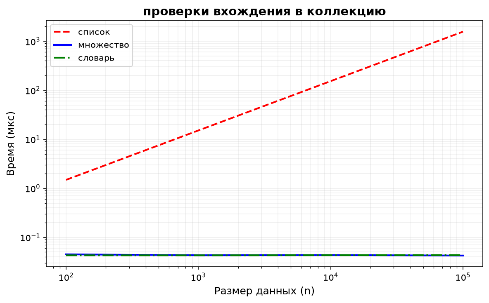
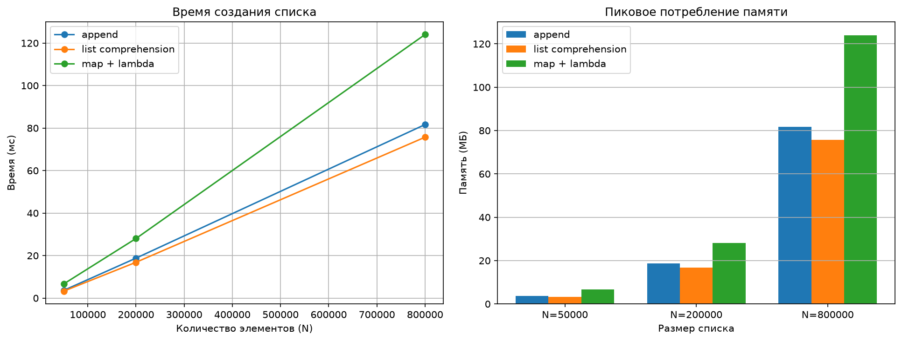

# Домашнее задание: 2 задачи по сравнению кода

Состоит из двух задач, полный текст [tasks.md](tasks.md)

## №1: Поиск элемента — `list` vs `set` vs `dict`

Исходный текст: [`hw1_search.py`](src/hw1_search.py)

Результат: 

|       n | t list мкс | t set мкс | t dict мкс | set быстрее в | dict быстрее в |
|---------|------------|-----------|------------|---------------|----------------|
|   1e+02 |  1.485e+00 |  0.044900 |   0.042900 |            33 |             35 |
|   1e+03 |  1.512e+01 |  0.043000 |   0.042900 |           352 |            353 |
|   1e+04 |  1.534e+02 |  0.043400 |   0.043100 |          3535 |           3560 |
|   1e+05 |  1.568e+03 |  0.042400 |   0.043300 |         36972 |          36204 |

График я сделал обе шкалы в логарифмическом масштабе, потому что значения по X тоже сильно отличаются.

## №2: Три способа создать список квадратов — время и память

Исходный текст: [`hw2_squares.py`](src/hw2_squares.py)

Результат: 

## Ответы на вопросы:

- Почему пиковая память у всех трёх способов почти одинаковая?
> По памяти все три способа примерно равны, так как создают одинаковый список.

- Почему list comprehension быстрее цикла с `append`?
> List comprehension обычно быстрее благодаря оптимизации выполнения в Python.

- Почему `map + lambda` обычно медленнее list comprehension?
> map + lambda может работать медленнее из-за накладных расходов на вызов lambda для каждого элемента

- Что изменилось бы по памяти, если бы мы создавали **генератор**, а не список?
> Генератор практически не использует память, память нужна только на хранение кода и локальных переменных.

(они же в файле [hw2_analysis.md](hw2_analysis.md))
